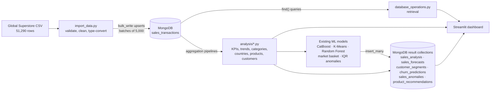

# MarketMind AI: MongoDB-Based Big Data Analytics for Small Business Sales Intelligence

MarketMind AI started as an Infosys Springboard internship project (Team 4): a sales intelligence
platform for small businesses with forecasting, customer segmentation, churn prediction, product
recommendations and anomaly detection.

This repository extends it into a **MongoDB-based analytics application** for the Big Data Analytics
practical activity:

> *Implement a MongoDB-based application to store big data for data processing and analysing the results.*

```
Collect (CSV) → Store (MongoDB) → Retrieve (find) → Process (aggregation pipelines + pandas)
             → Analyse (existing ML models) → Store results (MongoDB) → Visualise (Streamlit)
```

| Activity requirement | Where it is implemented |
|---|---|
| 1. Collect or import a dataset | `dataset/global_superstore_sales.csv`, `database/import_data.py` |
| 2. Store it in MongoDB | `MarketMindDB.sales_transactions` (51,290 documents), batched `bulk_write` upserts |
| 3. Retrieve stored records | `database/database_operations.py` (by customer, category, country, date range, top products) |
| 4. Process and analyse | `analysis/*.py`: aggregation pipelines plus the internship ML models |
| 5. Display the results | `dashboard/app.py`: Streamlit dashboard with 6 sections |

---

## 1. Problem statement

Small businesses record every sale but rarely turn those records into decisions. They need to see
where revenue comes from, which customers matter, what is unusual and what is likely next. The data
must also live in a database that can grow and be queried flexibly, not in a spreadsheet.

## 2. Objectives

1. Store a real retail sales dataset in MongoDB with proper data types, validation and indexes.
2. Make imports safe to repeat, with no duplicate transactions.
3. Retrieve and filter records directly from MongoDB.
4. Run the analytics inside the database with aggregation pipelines.
5. Reuse the internship project's trained models on data read from MongoDB, and store their
   predictions back in MongoDB.
6. Present everything in an interactive dashboard that reads only from MongoDB.

## 3. Technologies

| Layer | Technology |
|---|---|
| Language | Python 3.10+ |
| Database | MongoDB 7/8 (MongoDB Atlas or local Community Server) |
| Driver | PyMongo |
| Processing | MongoDB Aggregation Pipeline, pandas, NumPy |
| Machine learning | scikit-learn (K-Means, Random Forest), CatBoost |
| Visualisation | Plotly, Streamlit |
| Testing | pytest, run against a real MongoDB server |

## 4. System architecture



## 5. Dataset

`dataset/global_superstore_sales.csv` is the internship project's raw dataset
(`AIML/week1/data/dataset.csv`). These figures were verified by loading the file:

| Fact | Value |
|---|---|
| Rows | **51,290** (no duplicate rows, no duplicate Row IDs) |
| Columns | 25 |
| Period | 1 Jan 2011 to 31 Dec 2014 |
| Markets / countries | 7 markets, 147 countries |
| Customers / orders / products | 1,590 / 25,035 / 10,292 product IDs |
| Missing values | Only `Postal Code` (41,296 rows; postal codes exist only for US addresses) |

Columns: Row ID, Order ID, Order Date, Ship Date, Ship Mode, Customer ID, Customer Name, Segment,
City, State, Country, Postal Code, Market, Region, Product ID, Category, Sub-Category, Product Name,
Total amount (the sales value), Quantity, Discount, Profit, Shipping Cost, Order Priority, unit_price.

**About the "9,994 cleaned records".** The internship's `cleaned_dataset.csv` has 9,994 rows. It is
not a de-duplicated copy of the 51,290. It is the **US market subset** with extra lag features.
The trained models were built on that subset. So in this project:
- all **51,290** records are imported and used for the descriptive analytics;
- the ML steps run on the **US market (9,994 records)**, the data the models were trained on.
  This is set by `ML_MARKET` in `.env`.

## 6. MongoDB database design

Database: **`MarketMindDB`**

| Collection | Contents | Documents |
|---|---|---|
| `sales_transactions` | One document per sale (original Row ID as `_id`) | 51,290 |
| `sales_analysis` | One document per analysis type and scope (ALL or a market): KPIs, monthly, yearly, weekly, category, sub-category, country, market, segment, top products, high-value customers, model summaries | 94 |
| `sales_forecasts` | 30-day CatBoost daily forecast | 30 |
| `customer_segments` | K-Means cluster per customer | 793 |
| `churn_predictions` | Churn probability and risk level per customer | 793 |
| `sales_anomalies` | Unusual days and unusual transactions | 50 |
| `product_recommendations` | Top-5 "bought together" products per product | 8,263 |
| `import_log` | One entry per import run (counts, timing) | grows |

Example `sales_transactions` document:

```json
{
  "_id": 32298,
  "order_id": "CA-2012-124891",
  "order_date": ISODate("2012-07-31"),
  "ship_date": ISODate("2012-07-31"),
  "customer_id": "RH-19495", "customer_name": "Rick Hansen", "segment": "Consumer",
  "city": "New York City", "state": "New York", "country": "United States",
  "postal_code": "10024", "market": "US", "region": "East",
  "product_id": "TEC-AC-10003033", "category": "Technology", "sub_category": "Accessories",
  "product_name": "Plantronics CS510 - Over-the-Head monaural Wireless Headset System",
  "sales": 2309.65, "quantity": 7, "discount": 0.0, "profit": 762.1845,
  "shipping_cost": 933.57, "order_priority": "Critical", "unit_price": 329.95,
  "order_year": 2012, "order_month": 7, "year_month": "2012-07",
  "imported_at": ISODate("...")
}
```

**Design choices**
- **`_id` = original Row ID.** This gives a natural unique key, so re-importing updates rows
  instead of duplicating them.
- **Real types.** Dates are stored as BSON dates, money as doubles and quantity as an integer.
  Postal codes are stored as text, because they are labels.
- **Schema validation.** `sales_transactions` has a `$jsonSchema` validator: required fields,
  types, `sales ≥ 0`, `quantity ≥ 1` and `0 ≤ discount ≤ 1`. MongoDB rejects bad documents
  (there is a test for this).
- **Indexes** match the dashboard's queries: `order_date`, `(customer_id, order_date)`,
  `(category, sub_category)`, `country`, `(market, order_date)`, `product_id`, `order_id`,
  `sales` (descending). Result collections are indexed on their lookup keys.

## 7. Data import process (`database/import_data.py`)

1. Read the CSV as text. The script handles the byte-order mark that the original file has in its
   first header (`Row ID`).
2. Validate it: required columns must exist, and an empty file is reported clearly.
3. Clean it:
   - trim text;
   - parse `dd-mm-yyyy` dates;
   - convert numbers;
   - reject rows with an invalid or missing date, number, ID or name, negative sales,
     quantity below 1, a discount outside 0 to 1, or a repeated Row ID.

   Rejected rows go to `results/rejected_rows.csv` with the reason.
4. Write in batches of 5,000 with `bulk_write([UpdateOne(..., upsert=True)])`. `$setOnInsert`
   keeps the first import time.
5. Report the counts and verify them against `count_documents`, then log the run in `import_log`.

Actual output (first run, then a second run):

```
Rows read             : 51,290
Rows valid            : 51,290
Rows rejected         : 0
New documents inserted: 51,290
Documents in MongoDB  : 0 before -> 51,290 after
Time taken            : 5.80 s
Verification          : OK, every valid row is stored
----  second run  ----
New documents inserted: 0
Existing docs same    : 51,290
Documents in MongoDB  : 51,290 before -> 51,290 after
```

## 8. Data retrieval (`database/database_operations.py`)

| Function | MongoDB operation |
|---|---|
| `fetch_all_sales(limit, skip)` | `find({}).sort(order_date desc).skip().limit()` |
| `get_by_customer("TB-11280")` | `find({customer_id})` (uses the `customer_id, order_date` index) |
| `get_by_category("Technology")` | `find({category})` |
| `get_by_country("India")` | `find({country})` |
| `get_by_date_range("2014-01-01", "2014-01-31")` | `find({order_date: {$gte, $lte}})` |
| `search_transactions(**filters)` | combined filter, including a case-insensitive product name search |
| `get_top_products(10, by="revenue" or "quantity")` | `$group` → `$sort` → `$limit` |

Inputs are validated. A bad date, an end date before the start date, an empty customer ID or a
negative limit raises a clear `ValueError`. Text typed into the product search is escaped before it
is used as a regex.

## 9. Aggregation pipelines and analysis (`analysis/`)

| Analysis | Module | Pipeline stages |
|---|---|---|
| 1. Overall KPIs | `sales_analysis.overall_kpis` | `$match` → `$group` (`$sum`, `$avg`, `$addToSet`, `$min`, `$max`) → `$project` (`$size`, `$round`) |
| 2. Category-wise sales | `category_analysis.category_sales`, `sub_category_sales` | `$group` by category → `$sort` |
| 3. Country / market sales | `category_analysis.country_sales`, `market_sales`, `region_sales` | `$group` by country or market → `$sort` |
| 4. Top 10 products | `product_analysis.top_products` | `$group` by product → `$sort` → `$limit` |
| 5. Monthly sales and growth | `sales_analysis.monthly_sales`, `yearly_sales`, `weekly_sales` | `$group` by `$year`/`$month` (or `$isoWeek`) → `$sort`; pandas adds month-over-month growth and a 3-month average |
| 6. Customer analysis | `customer_analysis.high_value_customers`, `customer_summary` | `$group` by customer → `$sort` → `$limit` |
| 7. Anomalies | `anomaly_detection` | daily totals by `$group`; outliers fetched with a `$or` range query |

Only small aggregated results leave the database. The full 51,290 documents are never pulled into
pandas for the descriptive analytics.

**Results from the actual data (all markets)**

| Metric | Value |
|---|---|
| Total revenue | $12,642,501.91 |
| Total profit | $1,467,457.29 (11.61% margin) |
| Transactions / orders | 51,290 / 25,035 |
| Quantity sold | 178,312 |
| Average transaction / order value | $246.49 / $504.99 |
| Top category | Technology, $4.74M (37.5%) |
| Top market / country | APAC $3.59M (28.4%) / United States $2.30M (18.2%) |
| Top sub-category | Phones, $1.71M |
| Yearly growth | 2012 +18.5%, 2013 +27.2%, 2014 +26.3% |
| Best / weakest month | Nov 2014 ($555,279) / Feb 2011 ($91,152) |

## 10. Machine learning integration

Workflow: **MongoDB → aggregation → feature engineering → existing model → predictions → MongoDB**.

The trained models are copied unchanged from the internship repository (`AIML/week3/...`) into
`models/`. Feature engineering copies the original notebooks line for line, so the models get the
inputs they were trained on. Nothing was retrained.

| Module | Existing asset reused | What runs here | Verified result |
|---|---|---|---|
| Customer segmentation | `kmeans_clustering_model.pkl` (K-Means, k=3) | Features (total spend, line count, average line value) aggregated from MongoDB → StandardScaler → model | **793 of 793 customers get the same cluster** as the internship's saved `customer_segment.csv`. Segments: 63 high-value, 267 regular, 463 low-value |
| Churn prediction | `churn_model.pkl` (Random Forest, 11 features) | Recency, frequency, spend and profit features from MongoDB → `predict_proba`, threshold 0.52 | Probabilities match the internship's saved output within 0.00005 for all 793 customers. 201 high, 43 medium, 549 low risk |
| Sales forecasting | `catboost_daily_model.pkl` (log-target CatBoost, 25 lag features) | Daily totals from MongoDB → recursive 30-day forecast; 60-day one-step backtest | Backtest WAPE 37.2%, weekly MAPE 23.0% (in-sample, see limitations) |
| Product recommendations | Market-basket method from `recommendation.ipynb` | Baskets built with `$group` by `order_id` + `$addToSet` → support, confidence, lift | 8,263 rules, the same count as the original. Every pair present in both has identical confidence and lift |
| Anomaly detection | 3×IQR on daily totals (`updated_anomaly_detection.ipynb`) | Daily totals from MongoDB | **22 anomalous days, the same 22 dates** as the original. Upper limit $8,462.84 |
| Transaction anomalies (new) | none | Tukey 1.5×IQR on log(1 + amount) over all 51,290 transactions | 28 unusual transactions (above $5,634.57; the median sale is $85) |

The pickles are loaded through a **restricted unpickler** (`analysis/model_loader.py`). It only lets
the file rebuild scikit-learn, CatBoost, NumPy, SciPy and joblib objects, and refuses anything else
before it runs.

### Limitations (please read)
- **Churn accuracy is optimistic.** The churn label is "no purchase in the last 180 days", and the
  feature `RecencyVsAvgGap` is calculated from that same recency. The model is therefore partly
  reading the answer, which explains the high accuracy reported in the internship documents. Use the
  output as a risk ranking. The dashboard says this next to the results.
- **The forecast backtest is in-sample.** The CatBoost model was trained on this same history.
- **Recursive forecasts flatten.** Each day's prediction feeds the next one, and the forecast drifts
  low after the first week. The first days are the most useful.
- **Recommendations are sparse.** Most product pairs occur in only one or two orders.
- **Scale.** 51,290 records is a moderate dataset. This project shows MongoDB storage, indexing and
  aggregation on real data. It does **not** claim distributed processing, sharding or real-time
  streaming.

## 11. Dashboard (`dashboard/app.py`)

| Section | What it shows | Data source |
|---|---|---|
| Dashboard Overview | KPI cards (revenue, profit, transactions, customers, quantity, orders, averages, margin), monthly revenue, category and market charts | live aggregations |
| Sales Analytics | Monthly trend with a 3-month average, growth and decline table, category and sub-category revenue, country ranking and world map, top 10 products by revenue or quantity | live aggregations |
| Customer Analytics | High-value customers, K-Means segments (scatter, revenue, strategies), churn risk distribution and customer lists | live aggregation + `customer_segments`, `churn_predictions` |
| Predictive Analytics | 30-day forecast with backtest, anomalous days chart and table, unusual transactions, recommendation lookup per product | `sales_forecasts`, `sales_anomalies`, `product_recommendations`, `sales_analysis` |
| Transaction Explorer | Search by customer ID, category, country, date range and product name; shows the matching count, totals, the MongoDB query used, and a CSV download | `find()` on `sales_transactions` |
| MongoDB Status | Server version, documents, size and indexes per collection, import history, sample document | MongoDB commands |

The sidebar has a market filter, the connection status and a **Re-run analytics & ML pipeline**
button. If MongoDB is unreachable, the dashboard shows a clear error with steps to fix it instead of
crashing. Screenshots are in `docs/screenshots/`.

## 12. Installation

Requirements: Python 3.10 or newer, and either a MongoDB Atlas cluster (the free tier is enough) or
MongoDB Community Server 7 or newer installed locally.

```bash
git clone https://github.com/rrakshu60-dotcom/MarketMind_MongoDB.git
cd MarketMind_MongoDB
python -m venv venv
# Windows: venv\Scripts\activate      macOS/Linux: source venv/bin/activate
pip install -r requirements.txt
copy .env.example .env                 # macOS/Linux: cp .env.example .env
```

Edit `.env`:

- **Local MongoDB:** keep `MONGO_URI=mongodb://localhost:27017`.
- **MongoDB Atlas:**
  1. Create a free cluster.
  2. Under Database Access, add a database user.
  3. Under Network Access, allow your IP address.
  4. Click Connect → Drivers and copy the `mongodb+srv://...` string into `MONGO_URI`, replacing
     `<password>`.

`.env` is listed in `.gitignore`. Never commit it.

## 13. Running

```bash
python -m database.import_data            # 1. import CSV into MongoDB (safe to repeat)
python -m analysis.run_pipeline           # 2. run aggregations + ML, store results in MongoDB
streamlit run dashboard/app.py            # 3. open the dashboard (http://localhost:8501)
python scripts/demo_mongodb_operations.py # optional: terminal tour of every MongoDB operation
python -m pytest -v                       # tests (needs MongoDB running; uses MarketMindDB_test)
```

`python -m database.import_data --reset` drops and reloads the collection.
`--csv path/to/file.csv` imports another file with the same layout. Files that call the sales
column `Sales` instead of `Total amount` also work.

## 14. Testing

There are **32 automated tests** in `tests/`. They run against a real MongoDB server in a separate
`MarketMindDB_test` database, which is dropped afterwards. All 32 passed on MongoDB 8.0.23
(`results/test_report.txt`). They check:

- the connection, a fast failure with a clear message for a bad URI, and password masking;
- that collections, the validator and indexes are created, and that the validator rejects a bad
  document;
- an import of exactly 51,290 documents, a re-import that adds 0, and the stored types;
- that the cleaning rules reject each kind of bad row with the right reason, and that missing
  columns, an empty file and a missing file are handled;
- every retrieval function, compared with an independent pandas calculation on the CSV;
- KPIs, categories, countries, monthly growth and top customers, compared with pandas;
- the ML outputs, compared with the internship project's saved results (segments, churn, anomalies,
  recommendations), plus forecast sanity checks;
- that the pipeline stores results and a re-run replaces them instead of duplicating them, that it
  refuses an empty database, and that the model loader refuses unsafe pickles.

Sample outputs: `results/*.csv` and `results/sample_output_demo.txt`.

## 15. Project structure

```
MarketMind_MongoDB/
├── config.py                     settings from .env
├── dataset/global_superstore_sales.csv
├── database/
│   ├── mongodb_connection.py     connection, validation, schema validator, indexes
│   ├── import_data.py            CSV → MongoDB import
│   └── database_operations.py    retrieval functions
├── analysis/
│   ├── common.py                 shared helpers (scope filter, saving results)
│   ├── sales_analysis.py         KPIs, monthly, yearly, weekly, daily
│   ├── category_analysis.py      category, sub-category, country, market
│   ├── product_analysis.py       top products, recommendations
│   ├── customer_analysis.py      high-value customers, K-Means, churn
│   ├── anomaly_detection.py      daily + transaction anomalies
│   ├── forecasting.py            CatBoost forecast + backtest
│   ├── model_loader.py           safe loading of the trained models
│   └── run_pipeline.py           runs everything, stores results in MongoDB
├── models/                       trained models from the internship (+ reference outputs)
├── dashboard/app.py              Streamlit dashboard
├── scripts/demo_mongodb_operations.py
├── tests/                        pytest suite (real MongoDB)
├── results/                      sample outputs, test report
├── docs/                         project report, demo script, screenshots
├── .env.example  requirements.txt  pytest.ini
```

## 16. Results and conclusion

The application stores all 51,290 Global Superstore transactions in MongoDB with validation,
indexes and duplicate-safe imports. It retrieves and filters them with indexed queries, computes
every business metric with aggregation pipelines, and runs the internship's trained models on data
read from MongoDB. It stores the predictions back in MongoDB and presents everything in a Streamlit
dashboard. The ML integration reproduces the internship project's saved outputs exactly
(segmentation and anomalies) or to within rounding (churn). That shows the MongoDB-based pipeline
is faithful to the original work.

Full college report: [`docs/PROJECT_REPORT.md`](docs/PROJECT_REPORT.md) · Demo script:
[`docs/DEMO_SCRIPT.md`](docs/DEMO_SCRIPT.md)

## Credits

Built on MarketMind AI (Infosys Springboard internship, Small Business Sales Intelligence Platform,
SB7 Team 4). Dataset: Global Superstore (a public sample retail dataset).
