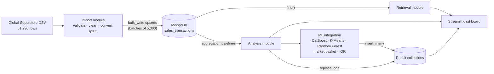
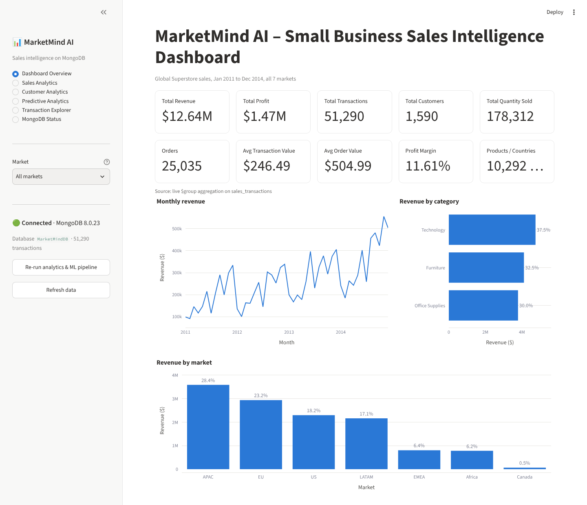
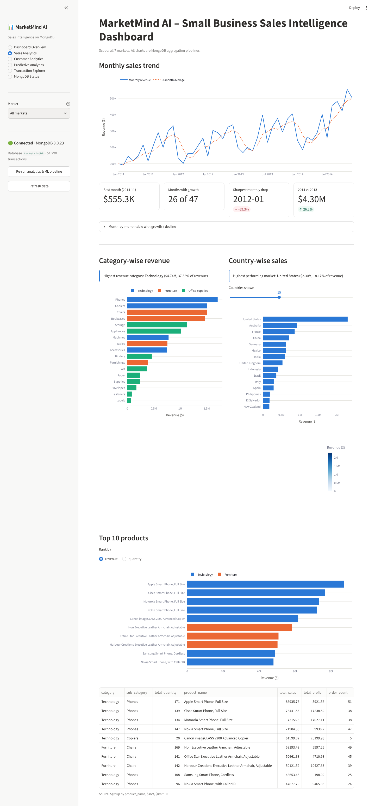
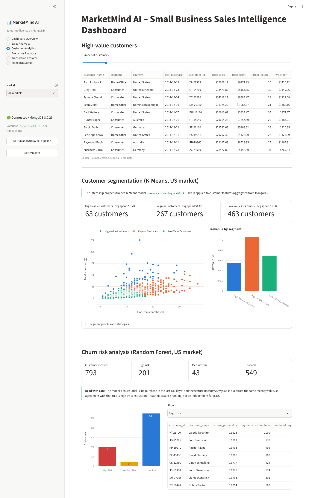
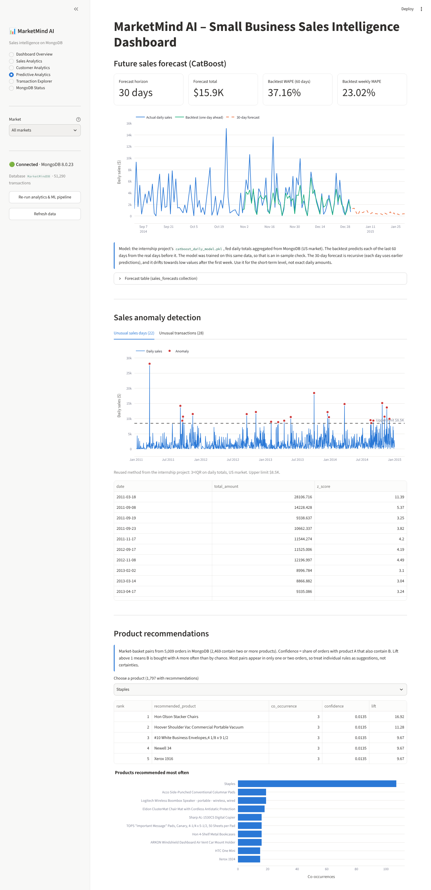
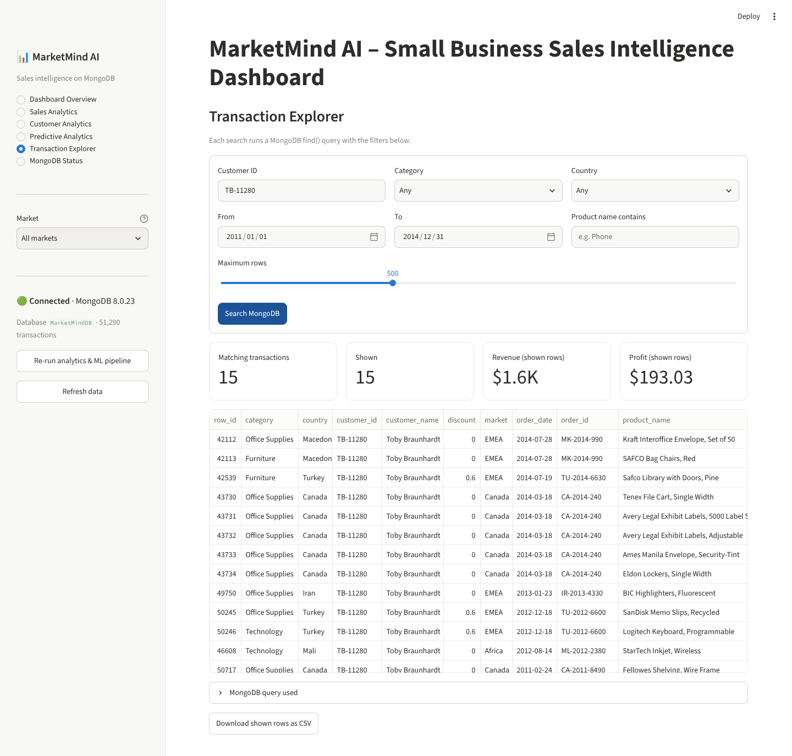
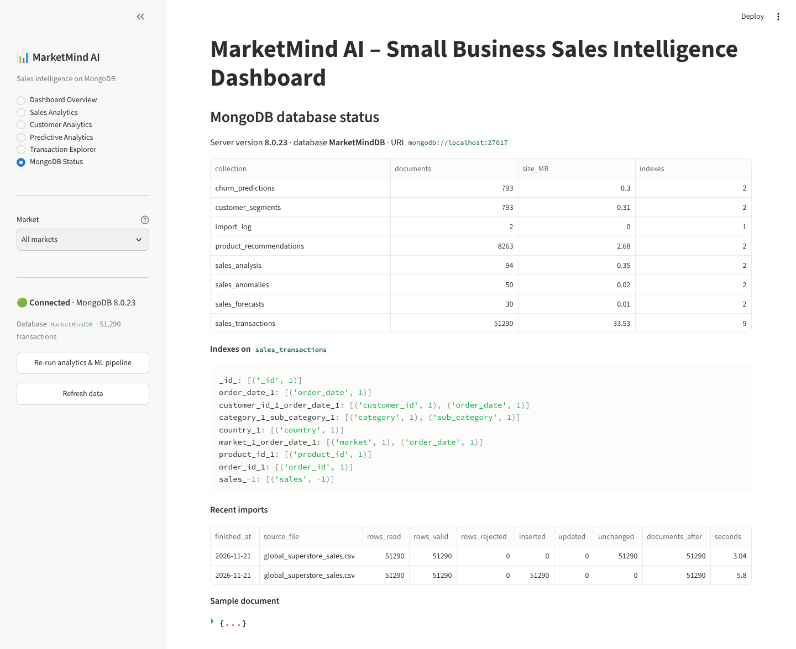
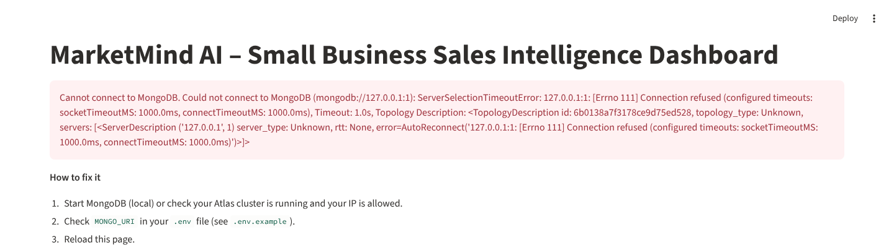

# MarketMind AI: MongoDB-Based Big Data Analytics for Small Business Sales Intelligence

**Big Data Analytics, Activity 1: MongoDB-Based Application (15 marks)**

*Name:* ____________________  *Roll No.:* ____________  *Class/Division:* ____________
*Guide:* ____________________  *Date of submission:* ____________

---

## 1. Abstract

Small businesses produce large volumes of sales records but rarely analyse them systematically.
This project extends **MarketMind AI**, a sales intelligence platform built during an Infosys
Springboard internship, into a MongoDB-based analytics application. The Global Superstore dataset
(51,290 transactions from 147 countries, 2011–2014) is validated, cleaned and stored in a MongoDB
database called `MarketMindDB` using batched, duplicate-safe bulk writes. Records are retrieved
through indexed queries. Business metrics (revenue, profit, category, country, monthly trend, top
products and customers) are computed inside the database with the MongoDB Aggregation Pipeline.

The internship's trained machine learning models are then applied to data read from MongoDB:
K-Means customer segmentation, Random Forest churn prediction, CatBoost sales forecasting,
market-basket product recommendations and IQR-based anomaly detection. Their predictions are stored
back in MongoDB, and a Streamlit dashboard presents all results. The MongoDB-fed pipeline reproduces
the internship's saved model outputs: identical customer segments and anomaly dates, and churn
probabilities within 0.00005. 32 automated tests run against a live MongoDB server and all pass.

## 2. Introduction

Retail sales data has three properties that suit a document database. Each transaction is a
self-contained record. The fields can vary between sources (postal codes exist only for some
countries, for example). And the data is queried in many different ways: by customer, by product,
by region, by period. MongoDB stores each sale as a JSON-like document, indexes any field, and
offers an aggregation framework that summarises data on the server.

MarketMind AI was originally built as a team internship project with a FastAPI and SQLite backend, a
Flask machine learning service and a Streamlit frontend. The models were trained and evaluated in
Jupyter notebooks on CSV files. This project keeps the models and the analysis methods, and makes
MongoDB the central store for both the raw data and the analytical results.

## 3. Problem statement

Implement a MongoDB-based application that stores a large sales dataset, retrieves and processes
it, analyses it (including the existing machine learning features), and displays the results, so
that a small business can understand its sales performance and customer behaviour.

## 4. Objectives

1. Import a real sales dataset into MongoDB with validation, correct data types and no duplicates.
2. Design collections, a schema validator and indexes suited to the analysis queries.
3. Implement retrieval by customer, category, country, date range and top products.
4. Implement seven analyses with aggregation pipelines: overall KPIs, category, country, top
   products, monthly trend, customers and anomalies.
5. Integrate the existing ML models on MongoDB data and store their outputs in MongoDB.
6. Build an interactive dashboard that reads only from MongoDB.
7. Test every layer against a real MongoDB server.

## 5. Software and hardware requirements

| Software | Version used / required |
|---|---|
| Operating system | Windows 10/11, macOS or Linux |
| Python | 3.10 or newer (tested on 3.13) |
| MongoDB | Atlas (free M0 tier) or Community Server 7+ (tested on 8.0.23) |
| Python libraries | pymongo, pandas, numpy, scikit-learn 1.9, catboost, joblib, streamlit, plotly, python-dotenv, pytest |
| Editor | VS Code or Jupyter Notebook |
| Browser | Any modern browser, for the dashboard |

| Hardware | Minimum |
|---|---|
| Processor | Dual-core, 2 GHz |
| RAM | 4 GB (8 GB recommended) |
| Disk | About 1 GB (libraries, about 35 MB of MongoDB data) |
| Network | Needed only for MongoDB Atlas and for installing packages |

## 6. Proposed system

The proposed system replaces file-based analysis with a database-centred workflow:

```
Data collection → MongoDB storage → Retrieval → Processing → Analytics & ML → Results in MongoDB → Dashboard
```

**Modules**
1. **Connection module.** Reads the URI from `.env`, validates the connection with a `ping`,
   masks the password in messages, and creates the collections, validator and indexes.
2. **Import module.** Reads, validates, cleans and type-converts the CSV, then does batched upserts.
3. **Retrieval module.** Filtered `find()` queries with input validation.
4. **Analysis module.** Aggregation pipelines for the seven analyses.
5. **ML integration module.** Feature engineering on MongoDB data, the existing trained models,
   and storage of the predictions.
6. **Dashboard module.** Streamlit interface with KPIs, charts, filters and tables.

**Advantages over the original file-based approach:** one source of truth; indexed, flexible
queries; database-side aggregation; safe repeated imports; and stored results that are versioned
with timestamps.

## 7. System architecture diagram



(The diagram renders on GitHub. For a printed report, paste the block into https://mermaid.live
and export it as PNG.)

## 8. Database design

**Database:** `MarketMindDB`

| Collection | Purpose | Key fields | Indexes | Documents |
|---|---|---|---|---|
| `sales_transactions` | Raw sales | `_id` (Row ID), order_id, order_date, customer_id, product_name, category, country, market, sales, quantity, profit | order_date; customer_id+order_date; category+sub_category; country; market+order_date; product_id; order_id; sales | 51,290 |
| `sales_analysis` | Computed analytics | analysis_type, scope, data, generated_at | analysis_type+scope (unique) | 94 |
| `sales_forecasts` | Forecasts | model, forecast_date, predicted_sales, horizon_day | model+forecast_date (unique) | 30 |
| `customer_segments` | K-Means results | customer_id, cluster, segment_name, features | segment_name | 793 |
| `churn_predictions` | Churn results | customer_id, churn_probability, risk_level | risk_level+churn_probability | 793 |
| `sales_anomalies` | Unusual days and transactions | level, date, amount, z_score | level+date | 50 |
| `product_recommendations` | Bought-together rules | product_name, recommended_product, confidence, lift, rank | product_name+rank | 8,263 |
| `import_log` | Import audit trail | rows read/valid/rejected, inserted, updated, time | none | 1 per run |

**Field mapping (CSV → MongoDB):** Row ID → `_id` (int), Order Date → `order_date` (date),
Total amount → `sales` (double), Quantity → `quantity` (int), Postal Code → `postal_code` (string),
and other columns become snake_case strings. Added fields: `order_year`, `order_month`,
`year_month` and `imported_at`.

**Schema validator** (`$jsonSchema`, strict): it requires 12 core fields and enforces types,
`sales ≥ 0`, `quantity ≥ 1` and `0 ≤ discount ≤ 1`.

**Why the original Row ID is the key:** the database then guarantees uniqueness. A repeated import
becomes an update (or a no-op), never a duplicate.

## 9. Implementation methodology

1. **Study the existing project.** The internship repository was inspected and the dataset was
   loaded directly to verify its figures: 51,290 rows and 25 columns, no duplicates, and missing
   values only in Postal Code. The "cleaned" 9,994-row file turned out to be the US market subset,
   which the models were trained on. The trained models were checked and could be loaded, and their
   feature definitions were read from the notebooks.
2. **Design.** Collections, the document structure, the validator and the indexes were planned
   from the queries the dashboard needs.
3. **Connection and import.** PyMongo with a cached client, a connection `ping`, environment-based
   configuration, cleaning rules, and batched `bulk_write` upserts.
4. **Retrieval.** Query builder with validation, and typed results as pandas DataFrames.
5. **Aggregation.** One pipeline per analysis. pandas is used only on small aggregated results,
   for example for growth percentages.
6. **ML integration.** Features rebuilt from MongoDB aggregations, exactly as in the notebooks.
   The existing models were applied without retraining, and the results were compared with the
   internship's saved outputs and stored in MongoDB.
7. **Dashboard.** Streamlit with Plotly charts, cached queries, filters and error handling.
8. **Testing.** pytest against a real MongoDB server, with independent pandas calculations as the
   expected answers.

## 10. MongoDB operations

**Create / insert (import):**
```python
ops = [UpdateOne({"_id": row_id}, {"$set": doc, "$setOnInsert": {"imported_at": now}}, upsert=True)
       for row_id, doc in batch]
db.sales_transactions.bulk_write(ops, ordered=False)
```

**Read (retrieval):**
```python
db.sales_transactions.find({"customer_id": "TB-11280"}).sort("order_date", 1)
db.sales_transactions.find({"category": "Furniture", "country": "France",
                            "order_date": {"$gte": datetime(2013,1,1), "$lte": datetime(2013,12,31,23,59,59)}})
```

**Aggregate (overall KPIs):**
```python
[{"$group": {"_id": None, "total_revenue": {"$sum": "$sales"}, "total_profit": {"$sum": "$profit"},
             "total_transactions": {"$sum": 1}, "total_quantity": {"$sum": "$quantity"},
             "avg_transaction_value": {"$avg": "$sales"}, "customers": {"$addToSet": "$customer_id"}}},
 {"$project": {"_id": 0, "total_revenue": {"$round": ["$total_revenue", 2]}, "total_customers": {"$size": "$customers"}, ...}}]
```

**Aggregate (monthly trend):**
```python
[{"$group": {"_id": {"year": {"$year": "$order_date"}, "month": {"$month": "$order_date"}},
             "revenue": {"$sum": "$sales"}, "orders": {"$addToSet": "$order_id"}}},
 {"$sort": {"_id.year": 1, "_id.month": 1}}]
```

**Aggregate (top 10 products):**
```python
[{"$group": {"_id": "$product_name", "total_sales": {"$sum": "$sales"}, "total_quantity": {"$sum": "$quantity"}}},
 {"$sort": {"total_sales": -1}}, {"$limit": 10}]
```

**Aggregate (market baskets for recommendations):**
```python
[{"$match": {"market": "US"}}, {"$group": {"_id": "$order_id", "products": {"$addToSet": "$product_name"}}}]
```

**Update / replace (stored analytics):**
```python
db.sales_analysis.replace_one({"analysis_type": "monthly_sales", "scope": "ALL"}, doc, upsert=True)
```

**Delete + insert (refresh model outputs):**
```python
db.sales_forecasts.delete_many({"model": MODEL_NAME}); db.sales_forecasts.insert_many(docs)
```

**Indexes and validation:** `create_index([("customer_id", 1), ("order_date", 1)])`, plus
`create_collection(..., validator={"$jsonSchema": ...})`.

## 11. Data analysis and results

All figures below were produced by the application from MongoDB.

**11.1 Overall (all markets)**

| Metric | Value |
|---|---|
| Total revenue | $12,642,501.91 |
| Total profit | $1,467,457.29 (margin 11.61%) |
| Transactions / orders | 51,290 / 25,035 |
| Customers / products / countries | 1,590 / 10,292 / 147 |
| Quantity sold | 178,312 |
| Average transaction value / order value | $246.49 / $504.99 |

**11.2 Category-wise sales**

| Category | Revenue | Profit | Share |
|---|---|---|---|
| Technology | $4,744,557.50 | $663,778.73 | 37.53% |
| Furniture | $4,110,874.19 | $285,204.72 | 32.52% |
| Office Supplies | $3,787,070.23 | $518,473.83 | 29.96% |

Technology earns the most revenue. Office Supplies is more profitable than Furniture despite lower
revenue, because Furniture's margin is only about 6.9%. The top sub-categories are Phones ($1.71M),
Copiers ($1.51M) and Chairs ($1.50M).

**11.3 Geographic sales**

| Market | Revenue | Share |
|---|---|---|
| APAC | $3,585,744.13 | 28.36% |
| EU | $2,938,089.06 | 23.24% |
| US | $2,297,200.86 | 18.17% |
| LATAM | $2,164,605.17 | 17.12% |
| EMEA | $806,161.31 | 6.38% |
| Africa | $783,773.21 | 6.20% |
| Canada | $66,928.17 | 0.53% |

The top countries are the United States ($2.30M, 18.2%), Australia ($0.93M), France ($0.86M),
China ($0.70M) and Germany ($0.63M).

**11.4 Top products:** the Apple Smart Phone (Full Size) leads, followed by Cisco, Motorola and
Nokia full-size smartphones and the Canon imageCLASS 2200 copier. Phones dominate the top 10.

**11.5 Trend:** yearly revenue grew every year: 2011 $2.26M, 2012 $2.68M (+18.5%), 2013 $3.41M
(+27.2%), 2014 $4.30M (+26.3%). Revenue rose in 26 of 47 month-to-month changes. There is clear
seasonality: sales are low in January and February and peak from September to December. The best
month was November 2014 ($555,279) and the weakest was February 2011 ($91,152).

**11.6 Customers:** the top customer is Tom Ashbrook ($35,668). Consumers account for 51% of
revenue. K-Means segmentation (US market, 793 customers): 63 high-value (average spend $8,679),
267 regular ($3,970) and 463 low-value ($1,491). Churn model: 201 high-risk, 43 medium-risk and 549
low-risk customers.

**11.7 Anomalies:** 22 unusual sales days in the US market (daily sales above $8,462.84; the largest
was $28,106.72 on 18 March 2011). Across all markets there were 28 unusual single transactions, the
largest a $22,638.48 videoconferencing unit sold at a 50% discount and a $1,811 loss.

**11.8 Forecast:** a 30-day CatBoost forecast for January 2015 is stored in `sales_forecasts`. A
60-day one-step-ahead backtest gives a WAPE of 37.2% and a weekly MAPE of 23.0%.

**11.9 Model verification**

| Model | Check | Result |
|---|---|---|
| K-Means | Clusters vs. internship output | 793 of 793 identical |
| Random Forest churn | Probabilities vs. internship output | max difference 0.00005 |
| Anomaly detection | Anomalous dates vs. internship output | same 22 dates |
| Recommendations | Rule count and metrics vs. internship output | 8,263 rules; identical lift and confidence on shared pairs |

## 12. Dashboard screenshots

| | |
|---|---|
| Dashboard overview |  |
| Sales analytics |  |
| Customer analytics |  |
| Predictive analytics |  |
| Transaction explorer (customer TB-11280) |  |
| MongoDB status |  |
| Connection failure handling |  |

## 13. Testing

32 automated tests (`pytest`) were run against MongoDB 8.0.23 in a separate test database. All 32
passed.

| # | Test area | Example check | Result |
|---|---|---|---|
| 1 | Connection | `ping` succeeds; a bad URI fails within 5 s with a clear message; the password is masked | Pass |
| 2 | Initialisation | Collections, the validator and indexes are created; running it twice is harmless | Pass |
| 3 | Validation | A document with negative sales is rejected by MongoDB | Pass |
| 4 | Import | 51,290 rows read = 51,290 documents stored | Pass |
| 5 | Duplicates | A second import inserts 0 and leaves 51,290 unchanged | Pass |
| 6 | Data types | `order_date` is a date, `sales` a double, `quantity` an int | Pass |
| 7 | Cleaning | A bad date, a non-numeric amount, quantity 0, a missing customer and a repeated ID are each rejected with the right reason | Pass |
| 8 | Bad files | Missing columns, an empty file and a missing file give clear errors | Pass |
| 9 | Retrieval | By customer, category, country, date range and combined filters match pandas counts | Pass |
| 10 | Top products | The top 10 order matches pandas | Pass |
| 11 | Invalid input | Reversed dates, bad dates, empty IDs and bad parameters raise `ValueError`; regex input is escaped | Pass |
| 12 | Aggregations | KPIs, categories, countries, monthly growth and top customers match pandas | Pass |
| 13 | ML | Segments, churn, anomalies and recommendations match the internship outputs; forecast sanity checks | Pass |
| 14 | Pipeline | Results are stored; a re-run replaces them without duplicates; an empty database is refused | Pass |
| 15 | Security | The model loader refuses a pickle that references `os` functions | Pass |

The dashboard was also exercised in a headless browser: all six sections rendered without errors,
the customer search returned 15 transactions for TB-11280, and with MongoDB stopped the dashboard
showed a clear connection error instead of crashing.

## 14. Conclusion

The project meets every requirement of the activity:

- a real dataset is **collected and imported**;
- it is **stored in MongoDB** with validation, indexes and duplicate-safe re-imports;
- records are **retrieved** with filtered queries;
- the data is **processed and analysed** with aggregation pipelines and the internship's machine
  learning models;
- the **results are displayed** in an interactive dashboard and stored back in MongoDB.

Reusing the trained models without retraining, and checking that they reproduce the original
outputs, keeps the work faithful to the internship project while moving its data layer to MongoDB.

**Honest limitations.**
- 51,290 records is a moderate dataset. The project shows MongoDB techniques used in big data
  systems, but not distributed processing or streaming.
- The churn model's label overlaps with one of its features (recency), so its accuracy is
  optimistic.
- The forecast backtest is in-sample, and recursive forecasts flatten after about a week.

## 15. Future enhancements

1. Shard the `sales_transactions` collection on Atlas for larger datasets, and use time-series
   collections for daily metrics.
2. Use MongoDB Change Streams to refresh analytics automatically when new sales are inserted.
3. Retrain the churn model on a future-window label (for example, "no purchase in the next 90
   days") without recency-derived features.
4. Add proper hold-out evaluation and prediction intervals for the forecast.
5. Add user authentication and role-based access to the dashboard.
6. Add a CSV upload page so a shop owner can import their own sales data.
7. Schedule the analytics pipeline (for example, nightly) and keep a history of results.

## References

1. MongoDB Documentation: Aggregation Pipeline, Indexes, Schema Validation, Bulk Write Operations.
2. PyMongo Documentation.
3. Streamlit and Plotly Documentation.
4. scikit-learn and CatBoost Documentation.
5. MarketMind AI, Small Business Sales Intelligence Platform: Infosys Springboard internship
   project, SB7 Team 4.
6. Global Superstore dataset (public sample retail dataset).
